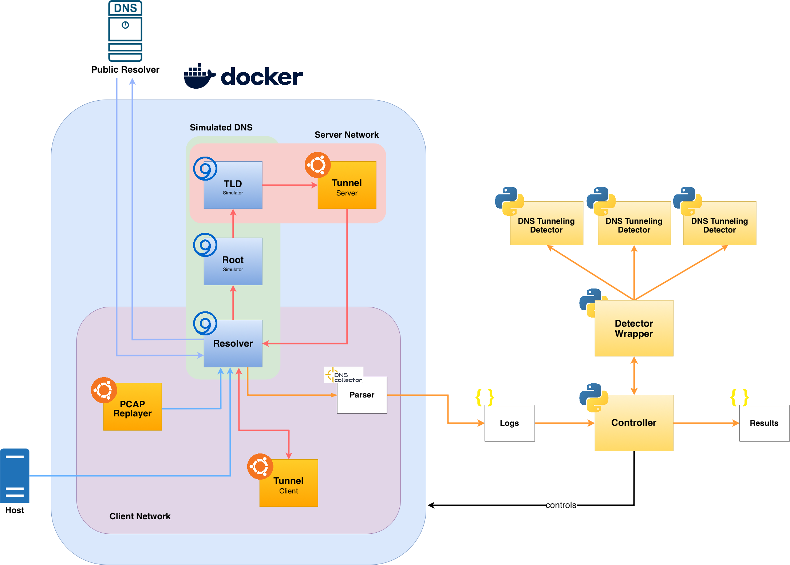

# TunFrame

TunFrame is a benchmarking framework for evaluating DNS tunneling detection methods against adversarial evasion techniques. It provides a standardized, reproducible environment to measure detection effectiveness under comparable conditions.

> Developed as part of the bachelor's thesis *"Evaluating adversarial evasion of DNS Tunneling Detection"*.

---

## Table of Contents

- [Prerequisites](#prerequisites)
- [Setup](#setup)
- [Project Structure](#project-structure)
- [How It Works](#how-it-works)
- [Adding a Detection Method](#adding-a-detection-method)
- [Adding a Tunneling Tool](#adding-a-tunneling-tool)
- [Configuring the Framework](#configuring-the-framework)
- [Running the Framework](#running-the-framework)
- [Output](#output)

---

## Prerequisites

Ensure the following are installed before using TunFrame:

- **Python** ≥ 3.9
- **Docker** and **Docker Compose**
---

## Setup

### 1. Create virtual environment

```bash
python3 -m venv .venv
source .venv/bin/activate
```

### 2. Install dependencies

```bash
pip install -r requirements.txt
```

### 3. Configure the framework

Edit `config.yaml` to specify your test run parameters. See [Configuring the Framework](#configuring-the-framework) for details.

---

## Project Structure

```
TunFrame/
├── main.py                        # Entry point (controller)
├── config.yaml                    # Main configuration file (see example_config.yaml)
├── requirements.txt
├── config/
│   ├── dns_config_generator.py    # Generates the BIND configs from templates
│   └── templates/
├── detection/
│   ├── evaluate.py                # Detector loading, peacetime/wartime loops
│   ├── reporting.py               # Per-run directory: run.json, run.log, configs/
│   ├── monitoring.py              # Live metrics and dashboard control requests
│   ├── report_charts.py           # Static charts and report.html of a run
│   ├── detector_base/
│   │   ├── detector_base.py       # Abstract base class for detectors, metrics
│   │   ├── feature_extraction.py  # Helpers for DNS-collector events
│   │   └── readfile.py            # Follows the DNS-collector JSON log
│   └── detectors/                 # One subdirectory per detection method
├── docker/
│   └── docker-compose.yml         # Resolver, simulated DNS hierarchy, collector, replayer, tools
└── scripts/
    ├── dashboard.py               # Local live dashboard for runs (http://127.0.0.1:8050)
    ├── dashboard_static/          # Dashboard page, styles and charts
    └── repro_harness.py           # Offline sanity checks for the harness (no Docker)
```

---

## How It Works



TunFrame runs an isolated DNS environment in Docker: a BIND resolver, a simulated root and TLD server that route the configured tunneling domains to the tunnel server, DNS-collector (which logs every query and response the resolver sees as JSON lines), and a tcpreplay container.

A run has these steps:

1. **Setup.** `main.py` validates the configuration, generates the BIND configs, clears the collector log while the containers are stopped, and starts the `essential` Docker profile.
2. **Peacetime (optional).** If `timing.peacetime_duration` > 0, the benign and wildcard replays start and every log line is fed to the detectors as benign. Every domain a detector alarms on is added to that detector's allowlist, merged with the global allowlist.
3. **Wartime.** Benign and wildcard replays continue (or start, if there was no peacetime). Tunnel traffic comes from one of two sources:
   - **Replay mode** (`traffic.tunnel.replay: true`): a tunnel pcap is replayed.
   - **DNSExfiltrator mode** (`dnsexfiltrator.enabled: true`): the DNSExfiltrator containers run one configuration after another (baseline, sweeps, profiles). Detectors are reset at every configuration boundary; allowlists are kept. Before each configuration, cached answers for the tunnel domains are flushed on the resolver, root and TLD servers (`rndc flushtree`), so every configuration reaches its own server.

   A wartime window ends when its timer expires, when every detector has flagged every tunneling domain, or (DNSExfiltrator mode, `dnsexfiltrator.stop_on_transfer_complete`) once the server has saved the exfiltrated file. In the last case the detectors first catch up with the log as it was at that moment, so every query of the transfer is evaluated. Windows ended this way differ in length; TN and FPR refer to each window. The results record how each window ended (`metadata.wartime_end`).
4. **Evaluation.** Each detector reports domain-level metrics for the window, and one results file is written per window (per configuration in DNSExfiltrator mode) into the run's directory. At the end of the run the console shows a summary table, and charts plus `report.html` are written.

Each replay is started once per run and never restarted, so wartime sees the part of a capture that follows the peacetime slice. The collector log is never truncated while the collector runs; each phase reads from the byte offset where it started.

---

## Adding a Detection Method

1. Create a new directory under `detection/detectors/` named after your method, containing `detector.py`.
2. In `detector.py`, subclass `Detector` from `detection/detector_base/detector_base.py` and implement `detect(logline)`: add the registered domain to `self.alarms` when it should raise an alarm.
3. Optionally override `on_phase_reset()` to clear internal state (windows, trackers) between DNSExfiltrator configurations.

Only `Detector` subclasses defined in `detector.py` are loaded. Select detectors with `detectors.active`.

---

## Adding a Tunneling Tool

1. Containerize the tunneling tool using Docker — create separate images for client and server.
2. Add both containers to `docker/docker-compose.yml`, connecting them to the appropriate networks:
   - Client → `client-network`
   - Server → `server-network`
3. In `config.yaml`, set:
   - `traffic.tunnel.tunneling_domains` – domain(s) the tool uses
   - `traffic.tunnel.tunnel_server_ip` – IP of the tunnel server (must be in `192.168.0.0/16` and match the server's IP in step 2)

Pre-recorded tunnel traffic can be used without a container through replay mode.

---

## Configuring the Framework

All settings are defined in `config.yaml`; `example_config.yaml` is a complete template. Durations are in **minutes**. Relative paths are resolved against the directory of `config.yaml` (`traffic.pcap_path` against the project root).

Renamed keys abort the run with a hint (`timing.duration` → `timing.wartime_duration`, `detector.names` → `detectors.active`). Unsupported keys (`traffic.tunnel.docker`, `traffic.tunnel.toolname`, `allowlist.local_allowlist_dir`) are ignored with a warning.

### Global Settings

| Parameter | Type | Required | Description | Default |
|---|---|---|---|---|
| `global.name` | string | No | Name of the test run, used in result file names | `experiment` |
| `global.description` | string | No | Description of the test run | none |
| `global.public_resolver` | IP | No | Public DNS resolver for non-tunneled queries | `1.1.1.1` |

### Detector Settings

| Parameter | Type | Required | Description | Default |
|---|---|---|---|---|
| `detectors.active` | list[string] | No | Detector directory names under `detection/detectors/` to load | all detectors |

### Timing Settings

| Parameter | Type | Required | Description | Default |
|---|---|---|---|---|
| `timing.wartime_duration` | number | No | Wartime duration in minutes (per configuration in DNSExfiltrator mode) | `60` |
| `timing.peacetime_duration` | number | No | Peacetime duration in minutes; `0` disables peacetime | `wartime_duration / 3` |

### Allowlist Settings

| Parameter | Type | Required | Description | Default |
|---|---|---|---|---|
| `allowlist.global_allowlist_path` | path | No | Global allowlist (e.g. Tranco top-1M). Accepts one domain per line, CSV such as `rank,domain`, tab/space columns and `#` comments. Entries are reduced to their registered domain (`ads.example.net` allowlists `example.net`) | none |

### Traffic Settings

#### General

| Parameter | Type | Required | Description | Default |
|---|---|---|---|---|
| `traffic.pcap_path` | path | **Yes** | Directory containing all PCAP files (mounted into the replayer) | — |

#### Benign and Wildcard Traffic

| Parameter | Type | Required | Description | Default |
|---|---|---|---|---|
| `traffic.benign.enabled` | bool | No | Replay benign DNS traffic | `false` |
| `traffic.benign.pcap` | string | If enabled | Filename of the benign PCAP | — |
| `traffic.benign.pps` | int | No | Replay rate in packets per second; unset or `0` replays at original speed | original speed |
| `traffic.wildcard.enabled` | bool | No | Replay wildcard DNS traffic (peacetime and wartime) | `false` |
| `traffic.wildcard.pcap` | string | If enabled | Filename of the wildcard PCAP | — |
| `traffic.wildcard.pps` | int | No | Replay rate in packets per second | original speed |

#### Tunnel Traffic

| Parameter | Type | Required | Description | Default |
|---|---|---|---|---|
| `traffic.tunnel.replay` | bool | No | Replay tunnel traffic from a PCAP (ignored when DNSExfiltrator is enabled) | `false` |
| `traffic.tunnel.pcap` | string | If replay | Filename of the tunnel PCAP | — |
| `traffic.tunnel.pps` | int | No | Replay rate in packets per second | original speed |
| `traffic.tunnel.tunneling_domains` | list[string] | **Yes** | Domains routed to the tunnel server; their registered domains are the ground truth for the evaluation | `[]` |
| `traffic.tunnel.tunnel_server_ip` | IP | No | Tunnel server IP, within `192.168.0.0/16` | `192.168.4.4` |
| `traffic.tunnel.expansion_factor` | number | No | Encoding expansion factor of replayed tunnel traffic (replay mode only) | `1` |

#### DNSExfiltrator

| Parameter | Type | Required | Description | Default |
|---|---|---|---|---|
| `dnsexfiltrator.enabled` | bool | No | Generate live tunnel traffic with DNSExfiltrator | `false` |
| `dnsexfiltrator.stop_on_transfer_complete` | bool | No | End a wartime window once the server reports the file as saved (`timing.wartime_duration` stays the upper bound) | `true` |
| `dnsexfiltrator.baseline` | mapping | No | Baseline configuration (named `baseline`) | defaults below |
| `dnsexfiltrator.sweeps` | list | No | `{name, parameter, values}`: one configuration per value, based on the baseline | `[]` |
| `dnsexfiltrator.profiles` | list | No | Named configurations; unset values come from the baseline | `[]` |

Valid parameters and their defaults: `file` (`/data/synthetic_cc_data_100.csv`), `password` (`tunframe`), `throttle` (`10`), `throttle_random` (`0`), `label_max_size` (`63`), `encoding` (`base32`; also `base32map`, `base64`, `hex`), `dilution` (`0`), `domains` (`[]`), `expansion_factor` (derived from `encoding`: 1.6, 4.8, 4/3, 2.0). Unknown parameter names abort the run. Every domain in `domains` must also be listed in `traffic.tunnel.tunneling_domains`.

### Output Settings

| Parameter | Type | Required | Description | Default |
|---|---|---|---|---|
| `output.logdir` | path | No | Directory for result files | `results` |

---

## Example Configurations

### Minimal — Replay Mode without benign traffic

```yaml
timing:
  wartime_duration: 120
  peacetime_duration: 0

allowlist:
  global_allowlist_path: "./allowlists/tranco.txt"

traffic:
  pcap_path: "./pcaps"
  tunnel:
    replay: true
    pcap: "tunnel.pcap"
    tunneling_domains: ["example.com"]
```

### Full — DNSExfiltrator with benign traffic and peacetime

See `example_config.yaml`.

---

## Running the Framework

```bash
(.venv) python3 main.py
```

Follow a run live (status per configuration, charts, log) in a second terminal:

```bash
(.venv) python3 scripts/dashboard.py            # http://127.0.0.1:8050
(.venv) python3 scripts/dashboard.py --results ./results --port 8051
```

The dashboard listens on `127.0.0.1` only and lists every run directory, so earlier runs stay browsable. Dark is the default theme; use the toggle or `?theme=light`. It shows:

- **Key figures:** status and phase, running time, estimated end (from the average duration of finished configurations, plus the latest possible end), configuration `i / n`, DNSExfiltrator transfer progress, DNS queries per second and the tunnel share.
- **Current configuration** with its parameters and window progress; all configurations (status, how each window ended, F1 per detector) in an expandable box.
- **Charts:** DNS queries per second (all vs. tunnel) over the run with configuration boundaries, transfer progress of the running configuration, CPU and memory per container and of `main.py`, detection results per configuration (F1, precision, recall, FPR, leakage; table view), and an F1 heatmap of detector × configuration.
- **DNS breakdown:** response codes and the most queried registered domains (tunnel domains marked).
- **Logs:** the run log and the DNSExfiltrator server and client output of the running configuration.
- **Controls:** *Skip configuration* evaluates the running window up to now, saves it as `interrupted` and continues with the next one; *Stop run* does the same and skips all remaining configurations. Both ask for confirmation. Requests carry a token embedded in the page and are only accepted from the dashboard's own origin; the run picks them up from `control.json` in its directory.

The metrics come from `metrics.jsonl`, which `main.py` writes into the run directory every two seconds (DNS rates from the collector log, transfer progress from the server log, `docker stats`).

Rebuild the charts and `report.html` of a run directory:

```bash
(.venv) python3 -m detection.report_charts results/<run>
```

Offline sanity checks for the harness (no Docker needed):

```bash
(.venv) python3 scripts/repro_harness.py
```

---

## Output

Every run gets its own directory in `output.logdir`, named `<global.name>_<YYYYmmdd-HHMMSS>`:

```
results/<name>_<timestamp>/
├── run.json              # run state, updated live: phase, progress, status and detector summary per configuration
├── run.log               # console log of the run
├── metrics.jsonl         # live metrics every 2 s: DNS rates, response codes, top domains, transfer progress, CPU/memory
├── control.json          # requests from the dashboard (skip configuration, stop run), if any
├── configs/<config>.json # full results of one wartime window (one per DNSExfiltrator configuration)
├── charts/*.png          # F1, FPR and uplink leakage per configuration; F1 over each sweep
└── report.html           # static report with the charts and the tables behind them
```

A run that fails or is interrupted after setup still gets `run.json` with status `failed` or `interrupted`, and configurations that never started are listed with their reason.

Each file in `configs/` contains:

- `metadata.run_status`: `completed`, `interrupted`, `skipped` or `failed`, with a reason. Skipped and failed configurations also get a file.
- `metadata.wartime_end`: how the window ended (`reason`: `transfer_complete`, `all_detected`, `timer`, `log_ended` or `interrupted`) and, in DNSExfiltrator mode, whether and after how many seconds the transfer completed.
- `metadata.dnsexfiltrator_config`: the exact configuration of the window (DNSExfiltrator mode).
- `metadata.run_info`: git commit and dirty flag, Python, library and Docker versions.
- `metadata.complete_config`: the full `config.yaml`.
- `metadata.dataset_statistics`: line, query and response counts of the window.
- `detectors`: per-detector metrics. Confusion-matrix classes are domain-level over the registered domains seen in the window (TN excludes FN). Leakage volume (`traffic_volume_up_bytes`, `traffic_volume_down_bytes`) counts the query payload and the answer RDATA of tunneling traffic until the detector's first alarm; allowlisted tunneling traffic is reported separately (`allowlisted_tunnel_*`).
