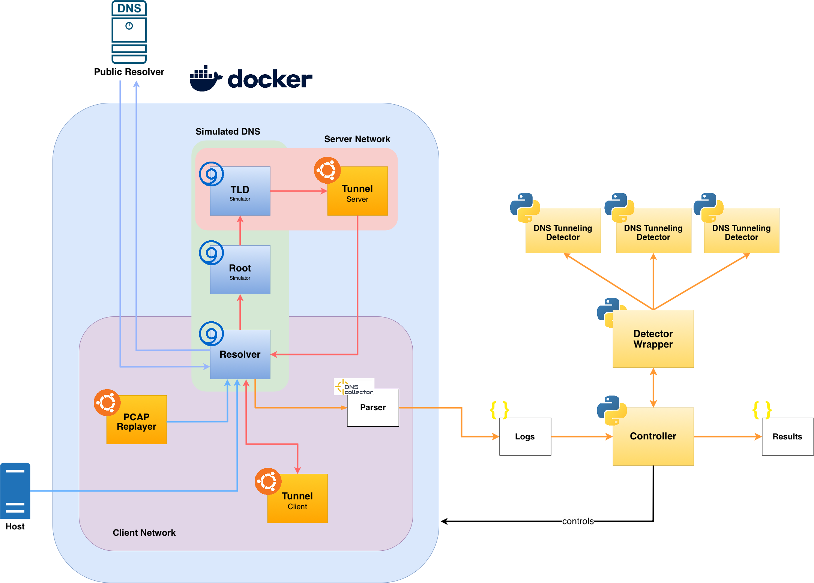

# Architecture



TunFrame runs an isolated DNS environment in Docker ([`docker/docker-compose.yml`](../docker/docker-compose.yml)) and a controller on the host ([`main.py`](../main.py)) that drives it, feeds the DNS log to the detectors and evaluates them.

## Services

| Container | Profile | Role | Address |
| --- | --- | --- | --- |
| `resolver` | `essential` | BIND recursive resolver that every client queries. Forwards the tunnel domains to the simulated root server and everything else to `global.public_resolver`. Published on host port `9999` | `172.16.0.2` (`client-network`), `10.1.1.1` (`internet`) |
| `root-simulator` | `essential` | BIND server standing in for the root: forwards the tunnel domains to the TLD server | `10.5.5.5` (`internet`) |
| `tld-simulator` | `essential` | BIND server standing in for the TLD: forwards the tunnel domains to the tunnel server | `10.10.10.10` (`internet`), `192.168.1.1` (`server-network`) |
| `dnscollector` | `essential` | [DNS-collector](https://github.com/dmachard/DNS-collector) on the resolver's network stack; writes every query and response the resolver sees as one JSON line to `docker/dns-collector/logs/dnslogs.json` | shares `resolver` |
| `pcap-replayer` | `essential` | `tcpreplay` on a dummy interface `replay0` in the resolver's network stack; replays the benign and tunnel pcaps from `traffic.pcap_path` (mounted at `/app`) | shares `resolver` |
| `dnsexfiltrator-client` | `dnsexfiltrator` | Exfiltration client, see [DNSExfiltrator](dnsexfiltrator.md) | `172.16.40.40` (`client-network`) |
| `dnsexfiltrator-server` | `dnsexfiltrator` | Exfiltration server, the authoritative end of the tunnel domains | `192.168.4.4` (`server-network`) |

Networks: `client-network` `172.16.0.0/16`, `server-network` `192.168.0.0/16`, `internet` `10.0.0.0/8`.

`main.py` starts the `essential` profile during setup and the `dnsexfiltrator` profile when the first DNSExfiltrator configuration begins, and stops everything at the end of the run.

## The simulated DNS hierarchy

The BIND configurations are generated at every run start by [`config/dns_config_generator.py`](../config/dns_config_generator.py) from the templates in [`config/templates/`](../config/templates/). For every **routed domain** it writes a forward zone:

```text
resolver ──► root-simulator ──► tld-simulator ──► tunnel server (traffic.tunnel.tunnel_server_ip)
```

The routed domains are the `domains` of all DNSExfiltrator configurations. `traffic.tunnel.tunneling_domains` is not routed: it only declares the tunnel domains inside a replayed pcap (see [Configuration](configuration.md#tunnel-traffic)); replayed tunnel queries are answered by the public resolver like any other name. The routed domains are also exempt from DNSSEC validation (`validate-except`). Every other name is forwarded by the resolver to the public resolver, so benign traffic resolves normally.

Before each DNSExfiltrator configuration TunFrame flushes the cached answers for its domains on all three BIND servers (`rndc flushtree`, over a loopback-only control channel whose key is generated per run), so every configuration reaches its own server instead of cached answers of the previous one.

## Where the detectors get their data

Replayed packets and the DNSExfiltrator client's queries all pass through the resolver, so the collector log contains the complete traffic of a run. `main.py` follows this log ([`detection/detector_base/readfile.py`](../detection/detector_base/readfile.py)) and hands every line to every detector. The log is cleared once at setup, while the collector is stopped, and never truncated during a run; each phase reads from the byte offset where it started.

Live metrics (DNS rates, record details, transfer progress, CPU and memory per container) are sampled from the same log, the DNSExfiltrator server log and `docker stats` by [`detection/monitoring.py`](../detection/monitoring.py); they never influence what the detectors see.
